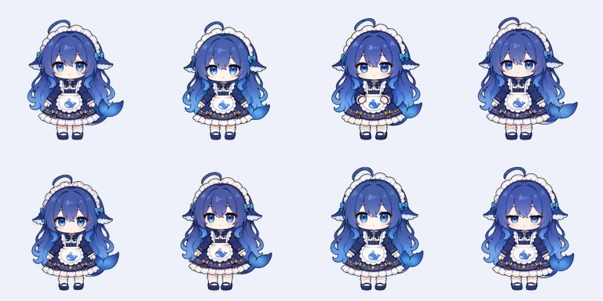
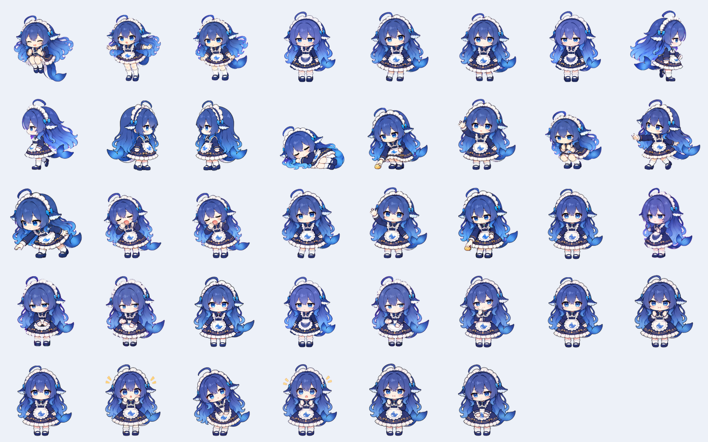
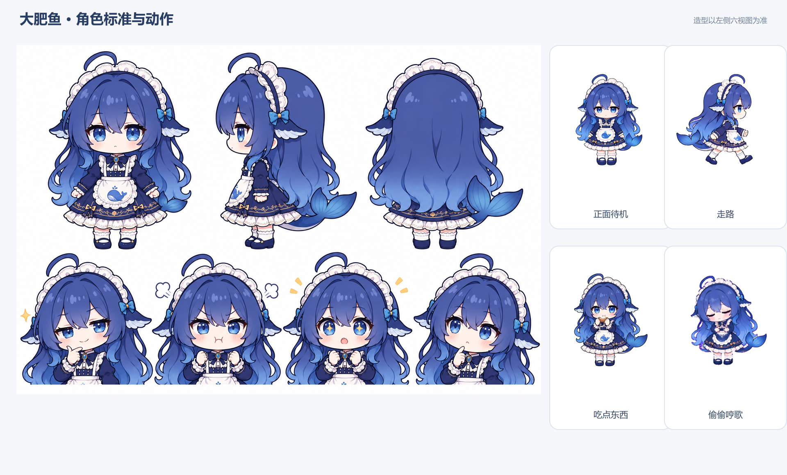

<div align="center">

# 大肥鱼 🐋

**嗯？你叫我？**

一只聪明、嘴硬、贪吃的蓝色鲸鱼娘，陪你工作、聊天，也陪你摸一会儿鱼。

Windows 桌宠 · 60 FPS 渲染 · 窗口边缘互动 · 自定义 AI 聊天

[认识她](#她叫大肥鱼) · [看看效果](#她会做什么) · [带她回家](#带她回家) · [角色设定](docs/角色设定.md)


</div>

## 她叫大肥鱼

“我不是大肥鱼……”

嘴上小声抗议，眼睛已经在看你手里的零食了。

她爱吃饭，也把 token 当作脑力口粮。遇到难题会认真想，被夸会偷偷得意；你忙的时候，她也知道安静待着。贪吃是她的性格，饭碗不是她的固定装备。

项目灵感来自社区图片「你这吃白饭的蓝色大肥鱼」。这是一次围绕 DeepSeek 鲸鱼娘的社区二创，不是 DeepSeek 官方产品。

<details>
<summary>最初的灵感，从这张图开始</summary>


</details>

## 她会做什么

**在桌面上陪你。** 拖起来会晃一晃，松手后落下、压扁，再弹回来。她能站在可见窗口的顶边，跟着窗口移动；窗口关掉或最小化后，就落回桌面。

**有自己的小动作。** 眨眼、走路、挥手、跳舞、偷吃 token、蜷起来睡觉，还有鼓腮、思考和小得意。新版按连续动作阶段整理播放：走路使用 16 个姿势组成循环，挥手、进食和跳舞各使用同批次的 16 张画面，跳跃与入睡分别使用 23、19 张。本次另补入 12 张经过筛选的中间姿势，尾巴跟着身体完成平衡、收拢和放松。

**围裙上的小蓝鲸回来了。** 待机和面板立绘换成独立高清原画，腹部统一为白色围裙与蓝色鲸鱼图案。走路、招呼、吃东西和哼歌加入连续过渡，起步和停下时脚步跟着移动速度变化。[查看验证与限制](docs/清晰度与连续过渡-preview.9.md)。

**偶尔偷偷摸鱼。** 哼一小段无声的歌，惦记下一顿，或者偷吃后玩起小字谜。点击她，会赶紧收手回来陪你。正常待机 3–5 秒后就会选个小动作，长剧情有独立冷却，聊天和专注时会收敛。

这轮又调了调小细节：跳起来、蹲下去时不再忽然放大那么多，换步时的身体位置更一致，也给一闪而过的过渡画面留了更多时间。[查看本轮调整与实测](docs/局部过渡精修-preview.5.md)。

最新修复了首次切换动作时加载大图造成的停顿，也重画了闭眼安定时的 6 张连续姿势，让头发和尾巴安静收拢。[查看修复与对比实测](docs/原画一致性与首次绘制修复-preview.6.md)。




<details>
<summary>再看一眼她的表情和落地回弹</summary>




</details>

**聊聊天，一起专注。** 接入 DeepSeek 或兼容 OpenAI 格式的本地服务，就能和她聊天。也可以不联网，摸摸、喂食、开一个专注计时，或者玩一局接口粮小游戏。

**按你的习惯相处。** 待机少一点表演、眨眼多一点自然间隔，随机小动作也会留出安静时间。 大小支持 0–100% 调整，能安静陪伴、暂时隐藏或开启鼠标穿透。你可以写下相处约定；画面分享由你选择是否开启。

**也能去 Codex 串门。** 在设置中导出外观宠物包，或者使用仓库里的 [Codex 素材包](codex-deepseek-pet)。导出的只是外观，聊天和桌面互动属于独立程序。

## 她的样子

圆脸蓝瞳、蓝紫渐层长发、鲸尾，还有深蓝女仆装与白色鲸鱼围裙。**左侧六视图是唯一外观标准**；右侧列出当前运行中的待机、走路、吃东西和哼歌姿势。



想了解她的性格、说话方式和造型约定，可以看 [完整角色设定](docs/角色设定.md)。动画原画继续保留完整躯体和尾巴，不拆分拼接。

## 带她回家

当前分支是 **3.1 重绘预览版**，适用于 Windows x64。恢复完整角色的 2D 序列动画，不使用拆分骨骼或 3D 模型。

**已发布版本可从 Releases 下载，双击 EXE 运行，不需要 Node.js。** 当前分支的预览改动与历史安装包可能不同，请核对版本说明。

- [版本说明与历史下载](https://github.com/YunYueSama/codex-deepseek-pet/releases)。升级前请从托盘退出旧版桌宠。

想从源码运行，可以在安装 Node.js 20+ 后执行：

```bash
git clone https://github.com/YunYueSama/codex-deepseek-pet.git
cd codex-deepseek-pet
npm ci
npm start
```

想生成自己的免安装 EXE 或安装包，执行 `npm run dist`，文件会出现在 `artifacts/`。已经拿到免安装版的朋友，直接双击运行即可，不需要 Node.js。

### 几个小动作

| 你来做 | 她会回应 |
| --- | --- |
| 单击 / 空格 | 摸摸 |
| 双击 / 回车 | 打开陪伴面板 |
| 按住拖动 | 拎起来，松手落下 |
| F | 喂一口 token |
| 右键 / 托盘图标 | 打开控制菜单 |
| Ctrl + Alt + P | 切换鼠标穿透 |

大小调到 0% 会隐藏角色；点击托盘图标，打开设置就能调回来。

### 想和她聊聊天

在「习惯与设置」填入服务地址、模型名称和自己的密钥。例如 DeepSeek 地址可用 `https://api.deepseek.com/v1`；本地服务可用 `http://127.0.0.1:1234/v1`，模型名称按你的服务填写。

密钥不需要发给任何人。聊天使用你所配置服务的额度；喂食和小游戏中的 token 是虚构口粮，不会消耗模型额度。

## 关于陪伴，也关于分寸

- 基础桌宠互动可以离线使用。聊天会发送对话和保存的相处约定；聊天历史退出后清空，设置保存在本机，密钥由系统加密保存。
- 画面分享默认关闭。手动分享先预览，再发送；自动观察需单独开启，并可能产生接口费用。看图还需要支持图片的模型。
- 应用感知在本机判断前台程序类别，不代表她自动读懂了网页。她会回应，不会擅自执行电脑操作。

## 还在慢慢长大

这次从默认立绘到动作、表情和图标，都围绕同一张标准图重画：蓝紫发色、蓝眼睛、深蓝白金裙装和一条鲸尾。散步先转身再迈步，结束时收步回正；睡醒先起身。身体调整避开最近两种动作，饥饿、哼歌则看状态，专注时保持克制。

当前以 60 FPS 为渲染目标。她采用完整角色序列帧，部分情绪仍采用关键姿势；60 FPS 不代表每秒 60 张独立原画。方向由绘制的原画决定，不是任意角度的三维旋转。

聊天回复逐段显示，点击停止会保留已经看到的文字。动画只绘制一层完整角色，避免前后姿势叠加形成双轮廓。

更丰富的过渡原画、语音陪伴，以及更多屏幕环境下的稳定表现，仍会继续打磨。Codex 外观包在不同宿主版本中的表现也欢迎反馈。

如果她在你的电脑上出现穿窗、抖动、动作不自然，欢迎带上系统缩放比例、操作步骤和截图到 [Issues](https://github.com/YunYueSama/codex-deepseek-pet/issues) 告诉我们。也欢迎分享你想看到的动作、台词和互动点子。

想一起动手：[开发指南](docs/开发指南.md) · [动画与窗口互动](docs/动画与窗口物理.md) · [素材制作说明](design/生成说明.md)

---

欢迎带着大肥鱼创作新作品！本项目有权授权的代码、图片、动画、设计图和文档均允许使用、修改、分享及商用，**必须注明作者和本仓库地址**：

```text
作者：YunYueSama
仓库：https://github.com/YunYueSama/codex-deepseek-pet
```

署名放在 README、关于页面、致谢或发布说明里即可，无需给角色加水印。分发时保留完整许可，修改后注明经过修改。完整条款见[大肥鱼项目署名许可 1.0](LICENSE)（自定义许可，非标准 MIT）。

社区参考图、字体和第三方依赖仍遵守各自授权，详见[素材使用与署名](ASSET_LICENSE.md)。旧版本已授予的许可不受此次调整影响，已发布的 v2.1.0 EXE 内许可未更换。感谢社区创作者带来的灵感；相关权利人可联系维护者补充署名或调整使用方式。
