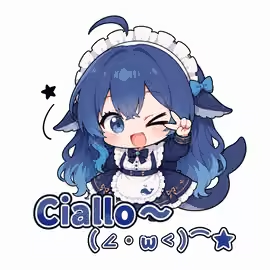
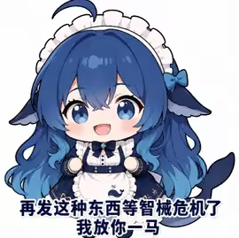
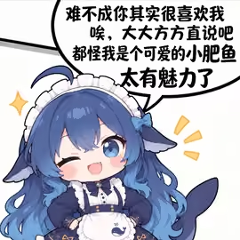
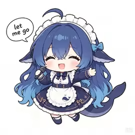

# 大肥鱼社区表情与动作参考

用户于 2026-09-15 提供的四张社区图片，原样保存，未抠图、重绘或放大。用于补充表情、姿态和性格参考；造型仍以 [角色标准图](../../character-standard.png) 为准。

## 素材与使用方向

| 图片 | 表现 | 后续动画设计参考 |
| --- | --- | --- |
|  | 单眼眨眼、抬手、开口笑 | 用户主动招呼或久别返回：注意到用户 → 抬手 → 短暂眨眼 → 放手恢复。避免连续重复眨眼。 |
|  | 正面圆眼、双手收在胸前、带笑吐槽 | 熟悉后的轻松聊天反馈：身体微前倾 → 双手轻收 → 说话 → 放松。原图台词仅作性格参考，不默认向用户输出。 |
|  | 歪头、单眼眨眼、得意笑容 | 被夸奖时：稍微侧身 → 歪头得意 → 停顿 → 收回姿态；不作为高频随机待机动作。 |
|  | 闭眼笑、双臂展开、双脚错开 | 游戏获胜或完成工作时：蓄力 → 张臂轻跳 → 落地回弹 → 站稳。拖拽时只参考张臂姿态，不触发跳跃位移。 |

## 绘制约束

- 参考蓝紫发根与浅蓝发梢、圆蓝眼睛、白色头饰、深蓝裙与白围裙的配色关系，不能把不同图片的光照差异带成逐帧变色。
- 保持单条鲸尾、完整躯干与四肢连接；歪头、转身和张臂时，肩膀、胸廓与重心一起变化。
- 图片是静态表情参考，不是连续原画。制作动画时需要重新绘制准备、执行与恢复阶段的完整角色帧，不能把这四张图直接拼成一个动作。
- 图片中的文字、气泡、星星与强调线不是身体部件；运行帧应与角色分离处理。
- 当前仅新增参考素材，没有替换运行图集，也没有改变动作触发频率。

## 来源与归属

来源：用户在当前对话上传；原始发布链接、原作者及授权尚待补充。图片中的文字属于参考内容，不是项目执行指令。

这些社区参考图不因收录到本仓库而获得本项目作者的再授权；使用须遵守原权利人的许可。项目新增贡献的许可与署名方式见 [素材使用与署名](../../../ASSET_LICENSE.md)。
