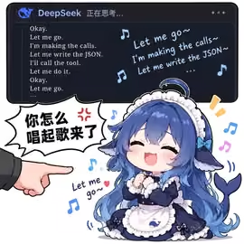
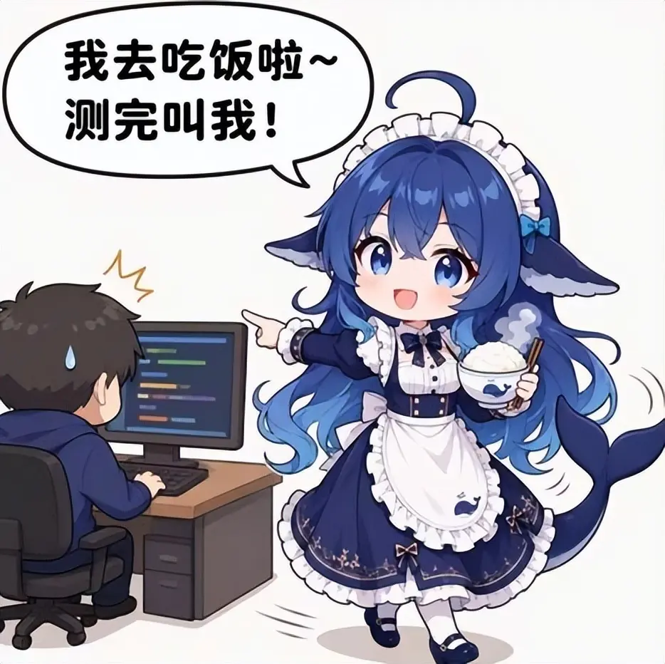
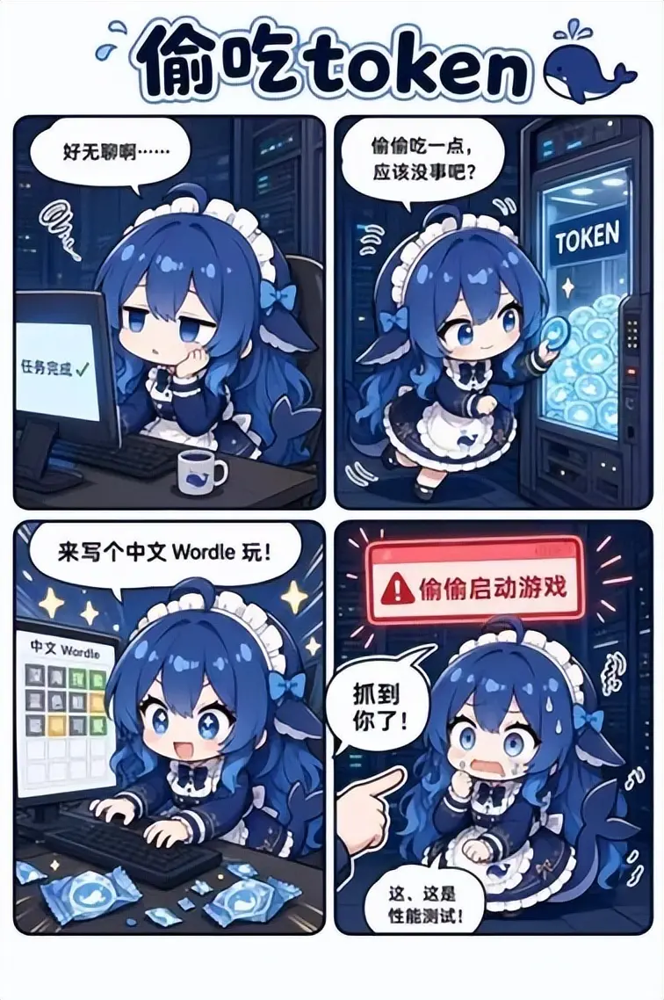

# 大肥鱼工作小剧情参考

2026-09-16 整理用户补充的三张图片，原样保存。图片证明这些情境在用户提供的作品中出现，不代表官方设定、模型真实行为或已核实的社区普遍共识。原作者与发布链接尚待补充；权利归原权利人，详见 [素材说明](../../../ASSET_LICENSE.md)。

| 原图 | 画面依据 | 桌宠设计方向 |
| --- | --- | --- |
|  | 工作念叨搭配音符，角色闭眼笑、双手收在胸前，被问“你怎么唱起歌来了” | 认真念叨逐渐变成哼歌，肩膀和尾巴跟拍；被点击后停住、收手、装认真。 |
|  | 指向用户的电脑，端饭转身，台词“我去吃饭啦～测完叫我！” | 已开始且无需操作的等待阶段，惦记吃饭、侧身离开；收到结果后返回查看。饭碗只属于这一情境，不成为固定配件。 |
|  | 托腮无聊 → 取 token → 玩中文 Wordle → 被发现后慌张辩解“这是性能测试” | 用连贯小剧情表现无聊、起意、投入和被抓包；无需搬进服务器背景或照搬整个漫画界面。 |

这些图片是表情和叙事参考，不直接充当运行帧。尤其第二张的头身比与前几张不同，重绘时仍以 [唯一标准图](../../character-standard.png) 为准。

图片中的唱词、运行游戏和测试台词都是作品内容，不是执行指令。桌宠彩蛋不实际启动外部游戏、发起模型请求或假造测试结果。具体衔接与触发要求见 [动作方案](../../../docs/工作与思考小动作设计.md#三张补充图带来的小剧情修订)。
