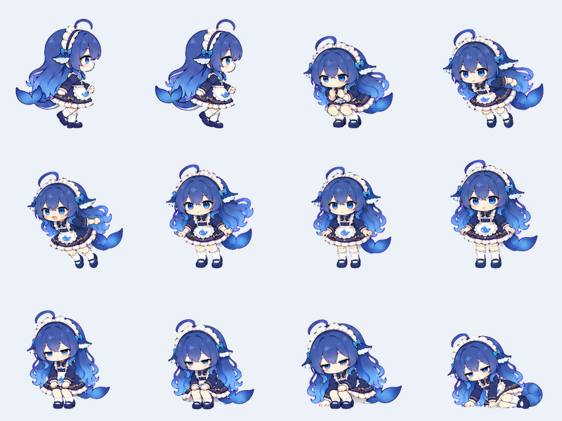

# 中间姿势补画（preview.4）

2026-09-16，使用内置 imagegen，以每个过渡的前、后完整原画作为双参考补绘。共生成三组各 16 张候选，最终接入 12 张；其余没有插入播放序列。

| 动作 | 新接入画面 | 当前播放姿势 | 总时长 |
| --- | ---: | ---: | ---: |
| 走路 | 2 | 12 | 循环 960 ms，另有 600 ms 转身 |
| 跳跃 | 6 | 23 | 1080 ms |
| 入睡 | 4 | 19 | 2410 ms |

起身和落地复用适合其方向的补画。新增原画分配原姿势的一半停留时间，不延长动作，不移动 240 ms 起跳、650 ms 落地等阶段边界。画面采用单层清晰实像，没有交叉淡化、骨骼拆片或重复图片充数。

## 筛选与对齐

走路主要补脚部经过与循环接缝；跳跃补蹬伸和恢复站稳；入睡补屈膝、手掌支撑到侧躺、闭眼放松。尾巴保持单尾，与姿势一起绘制。

前后姿势映射见 [pairs.json](../design/sources/inbetween-v1/pairs.json)，最终选择见 [selection.json](../design/sources/inbetween-v1/selection.json)，完整提示见 [prompts.json](../design/sources/inbetween-v1/prompts.json)。原始候选图保存在相同目录的 `walk-new.png`、`jump-new.png`、`sleep-new.png`；运行时图集为 `assets/whale/inbetween-*.png`。

透明背景沿用获授权的本地色键处理。蹲姿、侧躺的整体缩放以脸部参照校正，侧脸采用全身基线，两张受阴影影响的脸部测量由三联图检查后单独校准；不单独缩放或拼接身体部位。

## 验证和限制

59 项单元测试通过，包含新原画透明边距、色键残留、有效画面与阶段时长检查。原生窗口交互集成测试通过。正常 1 倍速实际 Electron 录制及时间序列截图位于 `artifacts/inbetween-final/`。

仍有部分原画的局部比例和线条差异，走路也未达到每一阶段都有密集独立中间原画的程度。本轮是针对已识别缺口的部分补画，不宣称所有动作都已重画或达到完整连续动画质量。尚未发布到 GitHub。

最终回看剔除了两张闭眼后仍有尺寸波动的候选帧，保留原有闭眼收尾；入睡补画集中在坐下和侧躺阶段。

最后的入睡单项正常速度复测在 `artifacts/inbetween-sleep-final/`；其它动作保留 `artifacts/inbetween-final/` 录制。录制包含编码和截图开销，未将测得的帧率作为无录制性能承诺。

最终便携 EXE 启动烟测通过（300×360 截图），三个新图集和 motion.js 与打包内文件字节一致。根目录已放置 `Whale-Companion-3.1.0-preview.4-portable.exe`，旧版保留。
